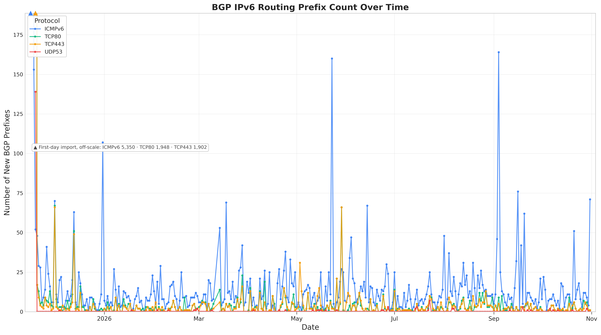
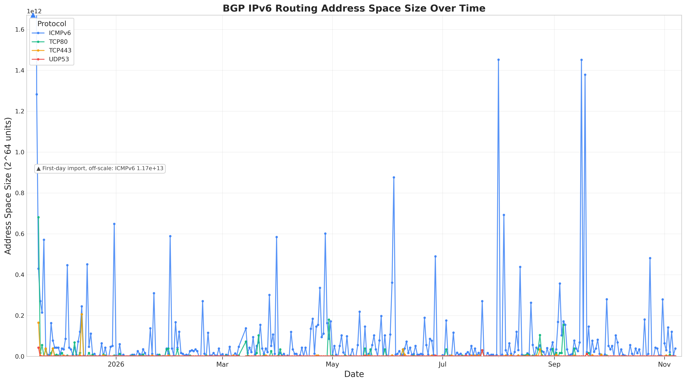
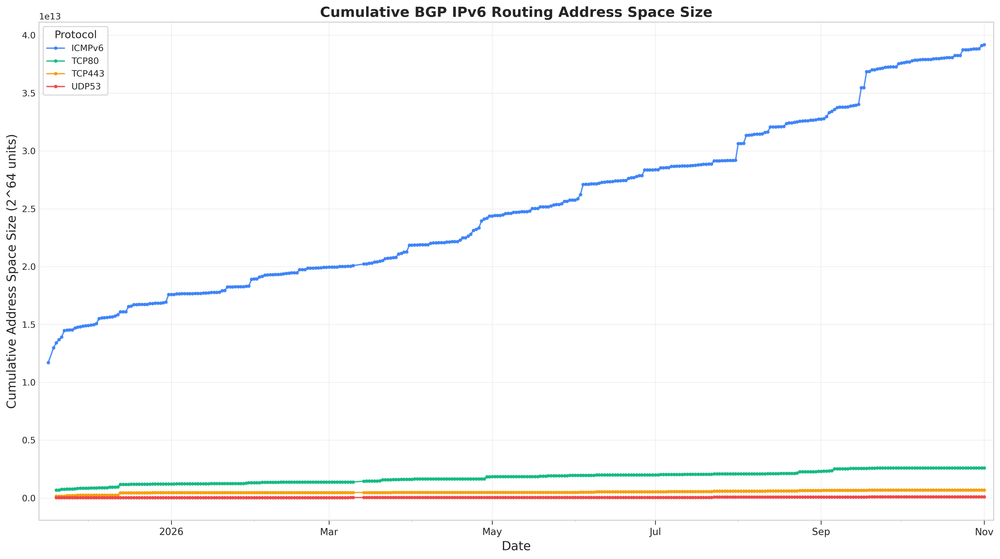
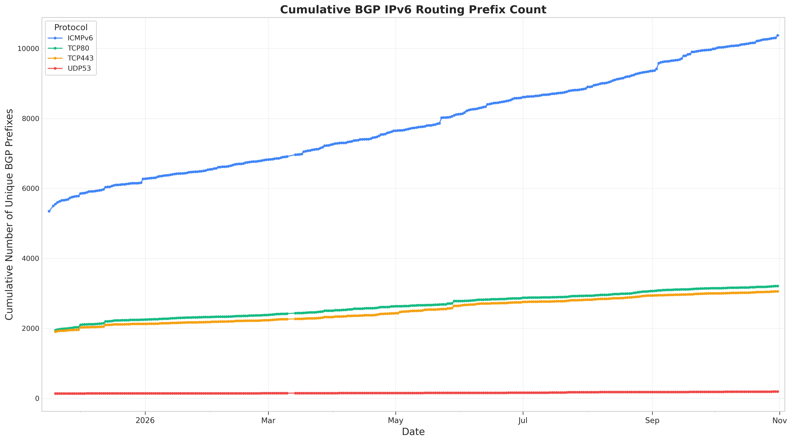

# FRP-watcher

[English](README.md) | **简体中文**

一个用于长期监测 IPv6 全响应前缀（FRP, Fully Responsive Prefix）的开源工具。基于成熟的现有算法完成全球范围的 IPv6 FRP 探测与数据采集。

## 分析结果

### BGP IPv6 路由前缀分析

我们对不同协议下 BGP 宣告的 IPv6 全响应前缀（FRP）进行持续分析，下图展示各项指标随时间变化的趋势：

#### 每日新增 BGP 前缀


#### 每日新增地址空间规模


#### 累计地址空间规模（去重）


#### 累计前缀数量（去重）


### 核心特性
- **去重分析**：所有累计指标均在去除重复前缀后计算
- **多协议支持**：覆盖 ICMPv6、TCP/80、TCP/443、UDP/53 四种协议
- **每日更新**：每天随新的测量结果更新数据
- **可视化洞察**：提供清晰、专业的图表，便于解读

### 目录结构
```plaintext
FRP-watcher/
├── server_Luori/        # Luori 服务器的 FRP 结果
├── server_gungnir/      # Gungnir 服务器的 FRP 结果
├── server_routing/      # BGP 宣告的 FRP 数据集
│   ├── ICMPv6/          # ICMPv6 探测下的 BGP FRP
│   ├── TCP80/           # TCP/80 探测下的 BGP FRP
│   ├── TCP443/          # TCP/443 探测下的 BGP FRP
│   ├── UDP53/           # UDP/53 探测下的 BGP FRP
│   └── analysis/        # 生成的分析图表与数据
├── all_shortest.txt     # 取目前所有累计 FRP 中最短的前缀
├── analyze_prefixes.py  # 生成分析图表的脚本
└── README.md            # 英文项目文档（本中文页面为 README.zh.md）
```

<!-- GUNGNIR_UPDATE_NOTES_START -->
## 最新的 Gungnir 扫描更新

本次长期检测逻辑更新（Gungnir 代码提交 945c1a4）：

- ICMPv6、TCP80、TCP443、UDP53 的活跃性扫描统一接入双 ZMap worker 流水线，使用共享时间窗配额、按需整数采样和工作保守（work-conserving）调度。
- 默认扫描参数为全局 5000 pps、每个 BGP 前缀平均 10 pps、每批最多 100000 个地址、AS 层不限速；四协议串行执行，避免协议之间速率叠加。
- 本轮活跃性扫描与粒度校正（Granularity Correction）均使用 75% 响应阈值并支持提前停止；论文中的 16/16（100%）规则仍作为可配置的基准模式保留。
- trap 检测沿用动态初始修正长度 lc（目标前缀长度减去 BGP 前缀长度，差值非正或未匹配时回退为 8）、规范父网合并、失败时步长减半以及 /0 边界终止。
- 活跃性扫描直接输出满足阈值的集合，不再经过旧提取器“至少 10 个响应”的二次筛选，使小地址空间的阈值语义保持一致。
- 本轮复用 2026-11-03 的四协议最新快照，不重新运行模型；输入与 trap 输出均执行最短覆盖筛选，不合并未复验的相邻兄弟前缀。
- 只有四协议全部成功后才统一发布并上传，任一阶段失败都不会发布不完整的结果。

运行标识：frp-refresh-20261106T122801Z
<!-- GUNGNIR_UPDATE_NOTES_END -->

## 引用

如果本论文对您的研究有帮助，欢迎引用。

```
@inproceedings{Wei2025gungnir,
  title = {Gungnir: Autoregressive Model for Unified Generation of IPv6 Fully Responsive Prefixes},
  author = {Wei, Chentian and Liu, Ying and He, Lin and Cheng, Daguo and Zhou, Jiasheng},
  booktitle = {Proceedings of the 33rd IEEE International Conference on Network Protocols (ICNP 2025)},
  year = {2025},
  pages = {},
  doi = {},
  address = {Seoul, South Korea},
  date = {September 22-25},
}
```

```
@INPROCEEDINGS{cheng2024luori,
  author={Cheng, Daguo and He, Lin and Wei, Chentian and Yin, Qilei and Jin, Boran and Wang, Zhaoan and Pan, Xiaoteng and Zhou, Sixu and Liu, Ying and Zhang, Shenglin and Tan, Fuchao and Liu, Wenmao},
  booktitle={2024 IEEE 32nd International Conference on Network Protocols (ICNP)}, 
  title={Luori: Active Probing and Evaluation of Internet-Wide IPv6 Fully Responsive Prefixes}, 
  year={2024},
  volume={},
  number={},
  pages={1-12},
  keywords={Protocols;Current measurement;Reinforcement learning;Transforms;Routing;Optimization;IPv6;fully responsive prefix;active probing},
  doi={10.1109/ICNP61940.2024.10858548}}
```
